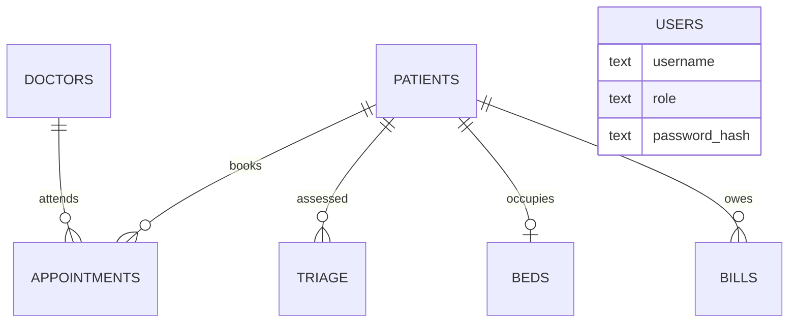

# Smart Hospital Management System

A web application that runs the daily work of a small hospital from one screen: registering patients, booking appointments, deciding who needs care first, assigning beds, dispensing medicine and billing.

**What makes it "smart":** it does not just store records. It makes decisions that save staff time and prevent mistakes.

| Smart feature | What it does |
|---|---|
| Triage scoring | Reads vitals and symptoms, gives a risk score, and puts the sickest patient first in the queue |
| Slot finder | Offers only free appointment times, so a doctor can never be double booked |
| Auto billing | Consultations, medicines and bed stays are billed automatically |
| Alerts | Low stock, expiring medicine and nearly full wards show on the dashboard |

## Run it (3 commands)

```bash
pip install -r requirements.txt
python app.py
# open http://127.0.0.1:5000
```

Sign in as `admin` / `admin123`. Other demo accounts: `reception` / `reception123`, `doctor` / `doctor123`, `pharmacist` / `pharma123`.
To check everything works: `python -m unittest -v` (10 tests should pass).

## How it is built

```
 Browser  --->  Flask (app.py)  --->  SQLite database (hms.db)
 (HTML pages)   routes + smart rules    7 tables, created automatically
```

| Layer | Technology | Where |
|---|---|---|
| Pages the user sees | HTML templates + CSS | `templates/`, `static/style.css` |
| Logic and rules | Python with Flask | `app.py` |
| Data storage | SQLite (a database in a single file) | `hms.db`, created on first run |
| Testing | Python `unittest` | `test_app.py` |

## Database



`MEDICINES` stands alone (stock, price, expiry). Appointments have a unique (doctor, time) pair, which is what makes double booking impossible.

## The triage rule, in plain words

Each warning sign adds points. The total decides the level.

| Warning sign | Points |
|---|---|
| Oxygen (SpO2) below 90% | 30 |
| Systolic blood pressure below 90 | 25 |
| Heart rate above 130 or below 40 | 15 |
| Symptom such as "chest pain" | 30 |
| Symptom such as "fever" | 8 |

**40 or more = Critical (sent to Emergency), 20+ = Urgent, 8+ = Semi-urgent, below 8 = Routine.**
The screen lists every rule that fired, so staff can see why a patient got their score. The full rule list is `triage_score()` and `SYMPTOM_RULES` in `app.py`.

## Who can do what

| Role | Can open |
|---|---|
| admin | Everything |
| reception | Patients, doctors, appointments, triage, beds, billing |
| doctor | Patients, doctors, appointments, triage, beds |
| pharmacist | Patients, pharmacy |

Passwords are stored hashed (never as plain text). Every page checks the user's role before opening.

## Project files

```
app.py            all the logic (start here)
templates/        one HTML page per module
static/style.css  the look and feel
test_app.py       10 automated tests
docs/PRESENTATION_GUIDE.md   how to explain and demo this project
```

## Honest limits

- The triage rules are a simple teaching model based on early-warning scores. They are **not a validated medical tool**.
- Security is basic. A real hospital would also need CSRF protection, login attempt limits, audit logs, HTTPS and data protection compliance.
- Demo accounts are shown on the login page. Set `HMS_DEMO=0` to hide them.

## Future work

User management screen, prescriptions and lab reports, PDF invoices, SMS reminders, and a machine learning model trained on real data to replace the hand-written triage rules.
